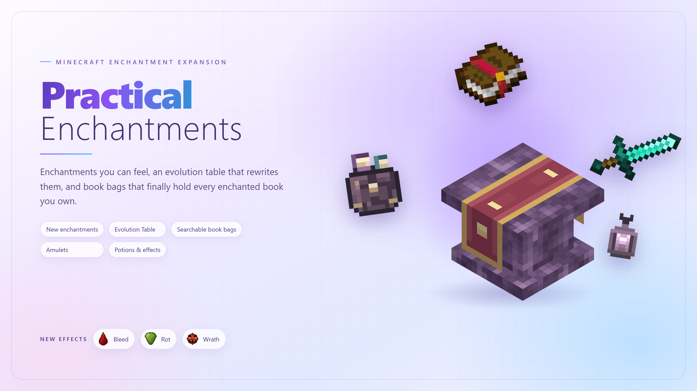
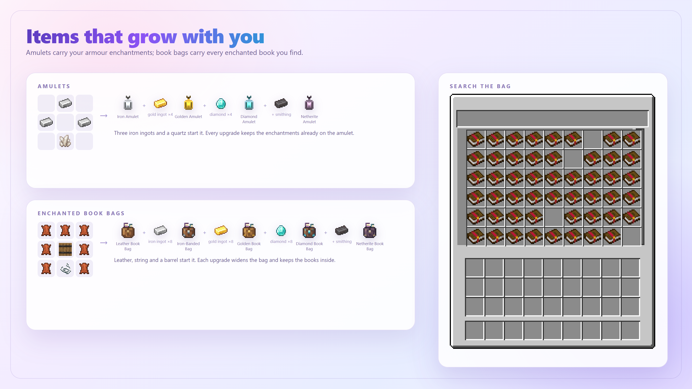

# Practical Enchantments

**English** | [简体中文](#简体中文)

---

## English

**Practical Enchantments** adds a collection of useful and fun enchantments that you can actually feel in play.

📖 **Full enchantment list:** [English](https://github.com/Huziyang520/Practical-Enchantments/blob/master/docs/ENCHANTMENTS_LIST.md) · [中文](https://github.com/Huziyang520/Practical-Enchantments/blob/master/docs/ENCHANTMENTS_LIST_CN.md)
📖 **Full effect and potion list:** [English](https://github.com/Huziyang520/Practical-Enchantments/blob/master/docs/EFFECTS_LIST.md) · [中文](https://github.com/Huziyang520/Practical-Enchantments/blob/master/docs/EFFECTS_LIST_CN.md)

### ✨ Featured Enchantments

| Enchantment | Applies to | What it does |
|---|---|---|
| **Bright** | Helmets | Grants permanent Night Vision while worn. |
| **Lumberjack** | Axes | Fells the entire connected tree (up to 64 blocks) with one chop. |
| **Life Steal** | Swords, axes | Heals you for a percentage of the health your target actually lost. |
| **Soul Siphon** | Swords, axes | Converts the damage you deal into experience orbs. |
| **Destruction** | Mining tools | Mined blocks drop experience instead of items. |
| **Smashing** | Tridents | A thrown trident breaks the block it hits; higher levels break harder blocks. |
| **Disguise** | Mob heads | Wearing a mob's head stops that kind of mob from attacking you on its own. |
| **Cat Charm** | Helmets | Creepers and phantoms keep their distance from you. |
| **Demonic Pact** | Chestplates | On lethal damage, pays emeralds to cheat death like a Totem of Undying, at the cost of Darkness. |
| **Zeus & Poseidon** | Tridents | Every hit calls down lightning, no storm needed; enough strikes in a row turn the weather itself into a thunderstorm. |

### 💠 Items

| Item | What it does |
|---|---|
| **Iron / Golden / Diamond / Netherite Amulet** | Worn in a trinket slot or held in the offhand. Armour enchantments work from an amulet, and upgrading keeps every enchantment already on it. |
| **Flawed Obsidian** | The block Obsidian Walker leaves on lava. It cracks through three stages and melts back into lava; breaking it turns it into lava too. |
| **Leather / Iron / Golden / Diamond / Netherite Book Bag** | Holds 27 / 54 / 81 / 135 / 216 enchanted books. The search box filters by enchantment name. |
| **Evolution Table** | Place an item or enchanted book carrying an evolvable enchantment on top, add lapis lazuli, and it evolves. Evolved enchantments are drawn with an animated rainbow name. |

### 🔮 The Evolution Table

- Right-click the table with an evolvable item or enchanted book to place it on top; right-click empty-handed to take it back.
- Right-click anything else to open the table and load lapis lazuli. It starts on its own once an item and enough lapis are present.
- Every attempt costs the lapis and may **evolve**, **transmute** into another enchantment, or **fail**.
- Success chance depends on the source enchantment and on the table's enchanting power, which comes from bookshelves and chiseled bookshelves holding enchanted books (empty chiseled bookshelves do not count). Full power is reached only with the full shelf setup.

### 🔧 Development Status

- **Dependency:** requires only [MerlinLib](https://github.com/Huziyang520/MerlinLib), installed on both client and server.
- **Settings:** NeoForge-side settings can all be modified in-game. For Forge and Fabric, choosing any one of Cloth Config, Jupiter, or MezzConfig will provide a visual configuration interface in-game.
- **Mod crossover:** the mod includes crossover content with other mods. Twilight Forest and The Aether are already supported, and more is planned. Crossover content only shows up in-game when the corresponding mod is installed.
- **Supported versions** :

| Minecraft | Loader |
|---|---|
| 1.20.1 | Forge |
| 1.21.1 | NeoForge |
| 26.1 – 26.2 | NeoForge + Fabric |
| 26.3 | NeoForge + Fabric |

Other versions are not planned.

### 💬 A Word from the Author

- If you run into any problem, feel free to report it anywhere you can think of.
- Have a great idea for a new enchantment? Tell me on GitHub or in the comment section here. Suggestions are very welcome!

---

## 简体中文

**实用附魔（Practical Enchantments）** 添加了一系列实用或有趣的附魔，优化你的游戏体验。

📖 **完整附魔清单：** [中文](https://github.com/Huziyang520/Practical-Enchantments/blob/master/docs/ENCHANTMENTS_LIST_CN.md) · [English](https://github.com/Huziyang520/Practical-Enchantments/blob/master/docs/ENCHANTMENTS_LIST.md)
📖 **完整效果与药水清单：** [中文](https://github.com/Huziyang520/Practical-Enchantments/blob/master/docs/EFFECTS_LIST_CN.md) · [English](https://github.com/Huziyang520/Practical-Enchantments/blob/master/docs/EFFECTS_LIST.md)

### ✨ 部分附魔一览

| 附魔 | 适用物品 | 效果 |
|---|---|---|
| **明朗** | 头盔 | 佩戴期间获得永久夜视。 |
| **伐木工** | 斧 | 砍一根原木即可破坏整棵相连的树木（单次上限 64 个方块）。 |
| **吸血** | 剑、斧 | 按目标实际损失的生命值，回复一定比例的血量。 |
| **汲灵** | 剑、斧 | 将造成的伤害转化为经验球。 |
| **毁灭** | 挖掘工具 | 挖掘的方块不再掉落物品，改为掉落经验。 |
| **粉碎** | 三叉戟 | 投掷的三叉戟会破坏击中的方块，等级越高能破坏的方块越硬。 |
| **伪装** | 各类生物头颅 | 戴上头颅后，对应的生物不再主动攻击你。 |
| **猫咪护符** | 头盔 | 苦力怕与幻翼会主动远离你。 |
| **恶魔交易** | 胸甲 | 受到致命伤害时消耗绿宝石免死（类似不死图腾），并附带黑暗效果作为代价。 |
| **宙斯与波塞冬** | 三叉戟 | 每次命中都召来闪电，不需要雷雨；短时间内连续召雷会把天气变成雷暴。 |

### 💠 物品
| 物品 | 作用 |
|---|---|
| **铁 / 金 / 钻石 / 下界合金护身符** | 装备在饰品栏或副手。护甲类附魔在护身符上同样生效，升级时已有附魔全部保留。 |
| **有瑕疵的黑曜石** | 龙晶行者踩过熔岩后留下的方块。它会分三阶裂开，最后熔回熔岩源；自己挖掉也会变回熔岩。 |
| **皮革 / 铁 / 金 / 钻石 / 下界合金附魔书袋** | 分别存放 27 / 54 / 81 / 135 / 216 本附魔书，搜索框按附魔名筛选。 |
| **进化附魔台** | 把带可进化附魔的物品或附魔书放上台面，放入青金石即可开始进化。进化出的附魔名称是流动的彩虹色。 |

### 🔮 进化附魔台

- 手持可进化的物品或附魔书右键台面即可放上去；空手右键可以取回。掉在台面上的同类物品会被自动吸附。
- 右键其他情况会打开界面，放入青金石。物品与青金石都到位后会自动开始。
- 每次进化都会消耗青金石，结果是**进化成功**、**转化为其他附魔**或**失败**三种之一。
- 成功率取决于原附魔与台子的附魔能力。附魔能力来自书架，以及放着附魔书的雕纹书架（空雕纹书架不算）。只有摆满整套书架才能达到满值。

### 🔧 开发情况

- **前置模组：** 仅需 [MerlinLib](https://github.com/Huziyang520/MerlinLib)，客户端与服务端都需要安装。
- **设置：** NeoForge 端设置都能在游戏内修改。Forge 和 Fabric 端在 Cloth Config、Jupiter 或 MezzConfig 中任选其一即可在游戏内拥有可视化配置界面。
- **模组联动：** 本模组与部分模组有联动内容，目前已支持暮色森林与天境，后续还有计划。联动内容需安装对应模组后才会在游戏内可见。
- **支持版本**：

| Minecraft 版本 | 模组加载器 |
|---|---|
| 1.20.1 | Forge |
| 1.21.1 | NeoForge |
| 26.1 – 26.2 | NeoForge + Fabric |
| 26.3 | NeoForge + Fabric |

其余版本暂无支持计划。

### 💬 作者的话

- 本模组的任何问题，欢迎你在能想到的任何地方反馈给作者。
- 如果你对新的附魔有好的创意，欢迎在 GitHub 或本页评论区告诉作者！